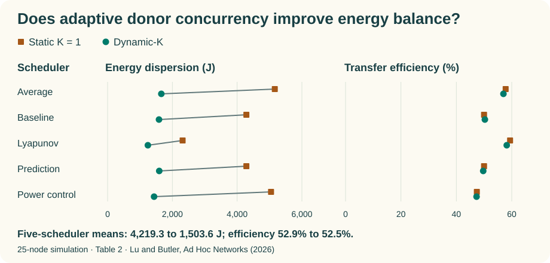

# Dynamic-K | From one donor to adaptive concurrency

A receiver can accept energy from more than one neighbour. Allowing a scheduler to change that limit can improve the balance of energy across the network. What happens to transfer efficiency when it does?



In the paper’s 25-node simulation, adaptive concurrency lowered mean node-energy dispersion from **4,219.3 to 1,503.6 J** across five schedulers. Mean transfer efficiency shifted from **52.9% to 52.5%**. Each line in the figure joins the two settings of the same scheduler. The two panels have separate axes and units.

## Run the demo

From this folder, using Python 3.8 or later:

```sh
python3 reproduce.py
```

The script runs one worked transfer, prints the five-scheduler comparison and writes `result.svg` in the working directory. No packages, network connection or hardware are required. To keep the included figure intact, choose a new path with `--output my-result.svg`.

```text
Illustrative single transfer (8 J requested):
  K=1: 1 active donor(s), 4.8 J received, 3.2 J unmet
  K=2: 2 active donor(s), 8.0 J received, 0.0 J unmet
Published five-scheduler comparison:
Mean energy dispersion: 4,219.3 -> 1,503.6 J
Reduction in mean dispersion: 64.4%
Mean transfer efficiency: 52.9% -> 52.5% (-0.4 percentage points)
Figure: result.svg
```

**Read the worked transfer.** The example has one receiver requesting 8 J and two donors considered in a fixed order. Donors A and B start with 8 and 6 J; each keeps 2 J in reserve. At an illustrative transfer efficiency of 80%, A can deliver 4.8 J. Allowing B to participate adds 3.2 J. These values are teaching inputs. The example isolates what changing the cap permits; it does not implement the paper’s feedback rule for choosing the cap.

**Read the published comparison.** The second part starts with the rounded scheduler-level values in Table 2, in the static single-donor and Dynamic-K columns. For each configuration it averages the five time-averaged node-energy standard deviations. The 64.4% reduction compares these two means; it is not the average of the five percentage reductions. The efficiency comparison is a difference in percentage points. This example recalculates the published result; it does not simulate node trajectories or replay hardware trials.

**Source:** Guoqing Lu and Bernard Butler, [Dynamic-K adaptation framework for energy transfer coordination in wireless sensor networks](https://doi.org/10.1016/j.adhoc.2026.104346), *Ad Hoc Networks*, vol. 193, article 104346 (2026), Table 2.

The [MIT license](LICENSE) applies to this result-demo script. The paper is available from the publisher under its own terms.
